# BidRadar

**Mapa ryzyk inwestycji wodno-kanalizacyjnych: podobne zakończone umowy z BZP, realne przedziały kosztów i opóźnień oraz czerwone flagi, zanim ogłosisz przetarg.**

[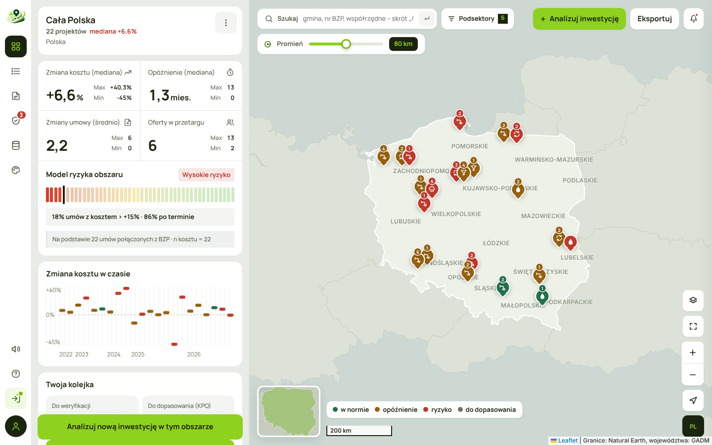](docs/screenshots/01-panel-mapa.png)

> **Uwaga:** zrzuty ekranu pokazują bazę pilotażową: 22 projekty wodno-kanalizacyjne i 26 842 zakończone umowy z Biuletynu Zamówień Publicznych. Wszystkie liczby da się odtworzyć na świeżej bazie poleceniami opisanymi niżej.

## Spis treści

1. [Problem, który rozwiązujemy](#problem-który-rozwiązujemy)
2. [Funkcje](#funkcje)
3. [Jak to działa](#jak-to-działa)
4. [Przegląd aplikacji](#przegląd-aplikacji)
   1. [Strona główna](#strona-główna)
   2. [Mapa ryzyk](#mapa-ryzyk)
   3. [Karta projektu](#karta-projektu)
   4. [Analiza nowej inwestycji](#analiza-nowej-inwestycji)
   5. [Panel eksperta](#panel-eksperta)
   6. [Dokumenty](#dokumenty)
   7. [Źródła danych i API](#źródła-danych-i-api)
   8. [Na telefonie](#na-telefonie)
5. [Wyniki](#wyniki)
6. [Źródła danych i łączenie rekordów](#źródła-danych-i-łączenie-rekordów)
7. [Technologie](#technologie)
8. [Architektura i model danych](#architektura-i-model-danych)
9. [Uruchomienie](#uruchomienie)
10. [Konfiguracja](#konfiguracja)
11. [Konta i role](#konta-i-role)
12. [Testy](#testy)
13. [Ograniczenia](#ograniczenia)
14. [Rozwiązywanie problemów](#rozwiązywanie-problemów)
15. [Struktura repozytorium](#struktura-repozytorium)
16. [Licencje danych](#licencje-danych)

---

## Problem, który rozwiązujemy

Inwestycje wodno-kanalizacyjne regularnie kończą się po terminie i drożej, niż zakładała umowa. Wiedza o tym, **dlaczego** tak się stało, istnieje, ale jest rozproszona:

- dane projektów leżą w rejestrach instytucji (KPO, fundusze UE),
- przebieg przetargu, zmiany umów i ich wykonanie – w setkach ogłoszeń w BZP i TED,
- przyczyny problemów – w aneksach, protokołach i pismach gmin.

Osoba przygotowująca nową inwestycję nie ma czasu tego przeszukiwać. BidRadar robi to automatycznie: łączy rekord projektu z jego ogłoszeniami, wyciąga zdarzenia ryzyka z cytatem ze źródła i porównuje nowy projekt z tysiącami zakończonych umów o podobnych cechach. Ekspert zatwierdza każdy wniosek, a każda liczba prowadzi do ogłoszenia lub dokumentu.

---

## Funkcje

- **Mapa ryzyk** – projekty i zakończone umowy na mapie Polski; wskazanie gminy, narysowanie obszaru albo ustawienie promienia przelicza statystyki obszaru.
- **Automatyczne łączenie źródeł** – rekord projektu → ogłoszenie o zamówieniu → wynik → zmiany umowy → wykonanie, po numerze BZP, OCID i NIP, a bez klucza po nazwie i zamawiającym z poziomem pewności.
- **Zdarzenia ryzyka R01–R15** – wykrywane jawnymi regułami z pól ogłoszeń i z dokumentów, zawsze z numerem ogłoszenia, polem formularza i cytatem; skutek w dniach i złotych, przyczyna, działanie zaradcze i jego skuteczność.
- **Analiza nowej inwestycji** – z opisu, pliku DOCX/PDF albo skanu: fakty z cytatem, braki w opisie, macierz ryzyk, podobne zakończone umowy z wyjaśnieniem podobieństwa, przedziały kosztu i terminu z liczebnością próby, rekomendowane zapisy umowne.
- **Panel eksperta** – zatwierdź, popraw, odrzuć (z komentarzem), oznacz jako wzorcowy, zatwierdzanie zbiorcze pewnych połączeń; poprawki zdarzeń, rekordów i powiązań; katalog ryzyk, wagi i podsektory bez programisty; pełna historia: kto, kiedy, co.
- **Dokumenty** – DOCX, DOC, PDF, skany z OCR, ODT, RTF, HTML; fakty z dokumentu sprawdzane krzyżowo z BZP, ponowna analiza po nowym pliku.
- **Monitorowanie** – co 6 godzin sprawdza nowe ogłoszenia dla trwających projektów; zmiana umowy trafia od razu na górę kolejki eksperta.
- **Eksport** – każdy rekord i analiza jako Markdown, Word (.docx), HTML do druku/PDF, JSON i CSV; pełne API z opisem OpenAPI 3.0.
- **Konta i role** – analityk i ekspert zatwierdzający, bezpieczne sesje, limit prób logowania.
- **Działa offline** – mapa, czcionki i granice są wbudowane; dane z BZP mogą pochodzić z lokalnej kopii.

---

## Jak to działa

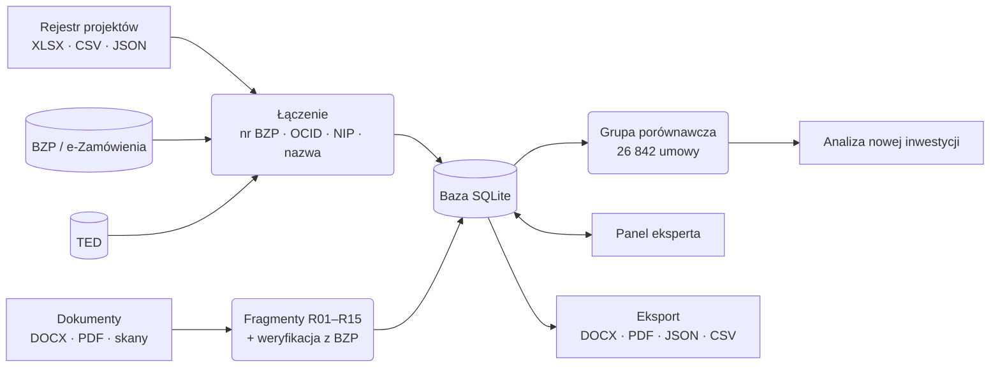

1. **Import** – rekordy projektów z pliku (XLSX, CSV, JSON, DOCX z tabelą, tekst „klucz: wartość”). Nagłówki są rozpoznawane po aliasach, więc inny układ pliku nie wymaga zmian w kodzie.
2. **Łączenie** – numer ogłoszenia jest normalizowany i weryfikowany z NIP zamawiającego. Gdy numeru brak, system szuka ogłoszeń zamawiającego o tym NIP i porównuje przedmiot zamówienia; wynik ma podstawę i procent pewności, a niepewne trafiają do eksperta.
3. **Zdarzenia** – reguły czytają pola ogłoszeń (termin 5.3, wartość 4.4 i 5.5, podstawa zmiany 5.2, liczba ofert) i fragmenty dokumentów; każde zdarzenie ma status „propozycja” do czasu decyzji eksperta.
4. **Grupa porównawcza** – 26 842 ogłoszenia o wykonaniu umów wod-kan z lat 2021–2026, podzielone na podsektory; nowy projekt porównujemy po podsektorze, wartości, regionie, formule i treści.
5. **Wynik** – mediana i percentyle kosztu oraz terminu z liczebnością próby, podobne umowy z linkami, czerwone flagi i rekomendacje; zawsze z oddzieleniem danych źródłowych, obliczeń i propozycji.

---

## Przegląd aplikacji

### Strona główna

Publiczna strona produktu z przejściem do panelu bez zakładania konta.

[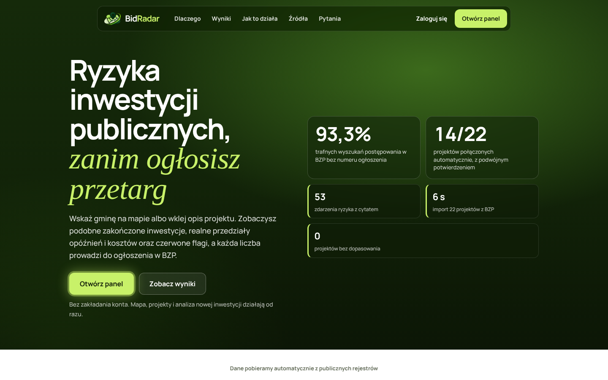](docs/screenshots/02-strona-glowna.png)

[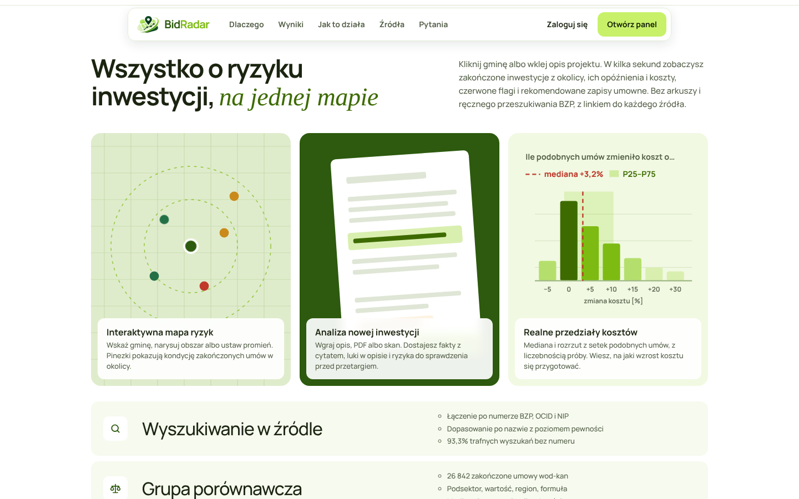](docs/screenshots/03-mozliwosci.png)

[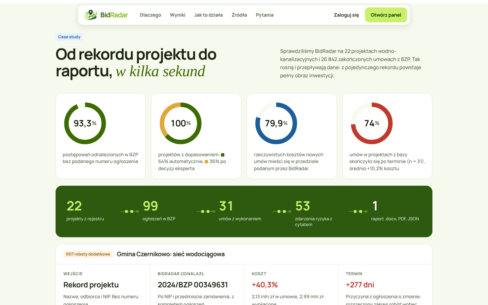](docs/screenshots/04-case-study.png)

### Mapa ryzyk

Po lewej statystyki wybranego obszaru: mediana zmiany kosztu i opóźnienia, liczba zmian umowy i ofert, model ryzyka obszaru i wykres zmian kosztu w czasie. Po prawej mapa z pinezkami w kolorze kondycji projektu. Wyszukiwarka przyjmuje nazwę gminy, numer BZP albo współrzędne.

[](docs/screenshots/01-panel-mapa.png)

| Element | Co robi |
|---|---|
| **Promień** | ustawia zasięg obszaru wokół wskazanego punktu (domyślnie 80 km) |
| **Podsektory** | filtruje projekty i grupę porównawczą (sieć wodociągowa, kanalizacja, oczyszczalnia…) |
| **Analizuj inwestycję** | otwiera analizę nowego projektu dla bieżącego obszaru |
| **Eksportuj** | rekordy z obszaru jako .docx, HTML, JSON lub CSV |
| **Dzwonek** | powiadomienia |

### Karta projektu

Kliknięcie pinezki otwiera kartę: daty podpisania i wykonania, kondycja projektu, odczyt z BZP z kwotami i opóźnieniem, dziennik ogłoszeń, zdarzenia ryzyka z przyczyną i skutkiem oraz rekord projektu z powiązaniem.

[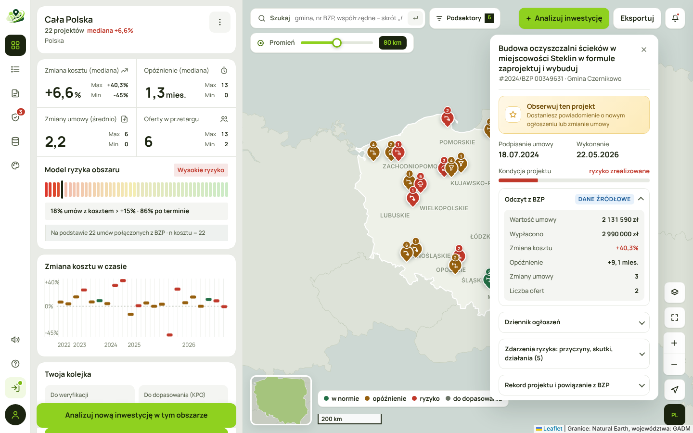](docs/screenshots/05-karta-projektu.png)

Ekspert poprawia zdarzenie w miejscu: kategoria, status, przyczyna, skutek w dniach i złotych, działanie zaradcze i jego skuteczność. Wartości wyliczone z BZP są podpisane źródłem, poprawione – nazwiskiem eksperta i godziną. Poprawki przetrwają ponowny import danych.

[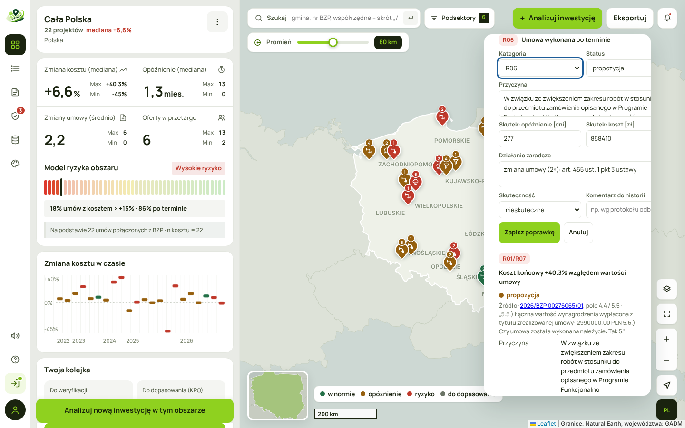](docs/screenshots/06-poprawka-zdarzenia.png)

### Analiza nowej inwestycji

Wystarczy opis w kilku zdaniach albo plik (DOCX, PDF, skan). System rozpoznaje podsektor, długość sieci, liczbę przepompowni, formułę i wartość.

[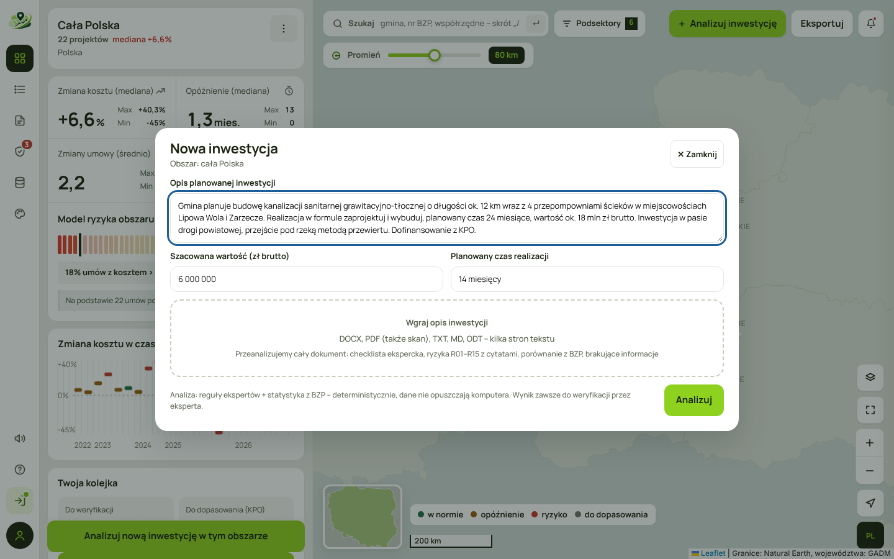](docs/screenshots/07-nowa-inwestycja.png)

Wynik: grupa porównawcza z liczebnością, przedziały zmiany kosztu i opóźnienia, podobne zakończone umowy z wyjaśnieniem, **dlaczego** są podobne, i z linkiem do BZP, a dalej ryzyka, braki w opisie i rekomendowane zapisy umowne. Raport pobierzesz jako .docx, .md, HTML lub JSON.

[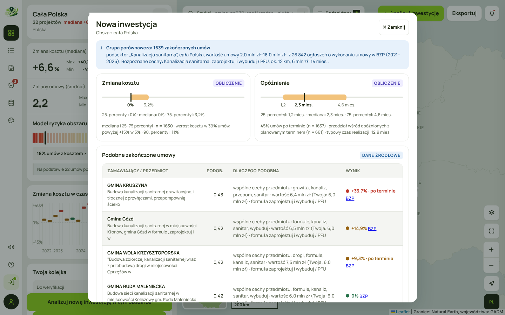](docs/screenshots/08-wynik-analizy.png)

### Panel eksperta

Kolejka od najmniej pewnych propozycji. Każda decyzja wymaga komentarza przy odrzuceniu i trafia do historii. Pewne połączenia (≥ 90%) można zatwierdzić zbiorczo, a każde zostaje zapisane osobno.

[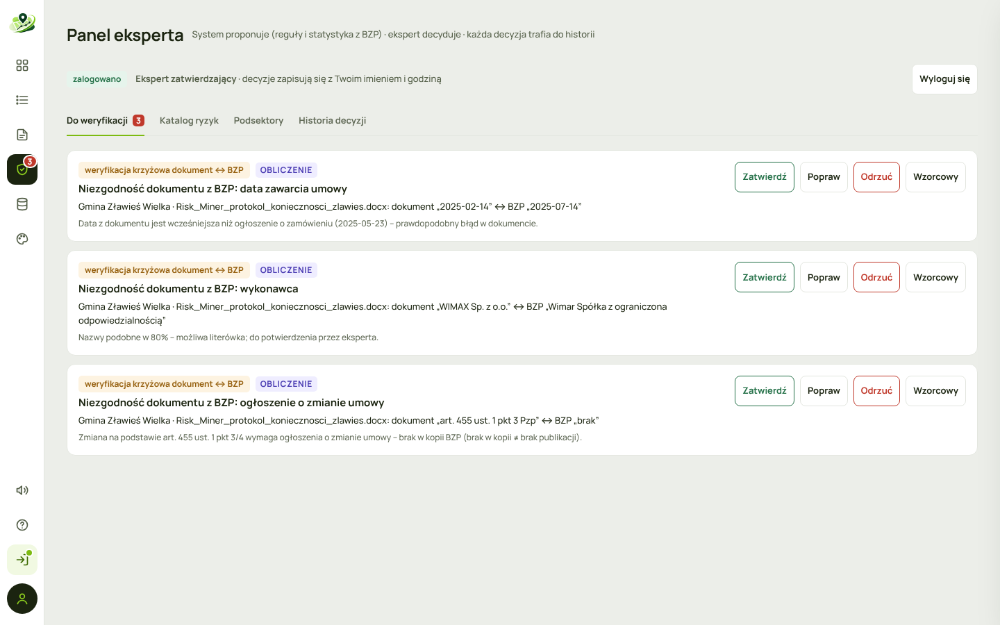](docs/screenshots/09-panel-eksperta.png)

| Zakładka | Zawartość |
|---|---|
| **Do weryfikacji** | propozycje połączeń, zdarzeń i niezgodności dokumentów z BZP |
| **Katalog ryzyk** | kategorie R01–R15 i nowe kategorie, wagi podobieństwa |
| **Podsektory** | reguły przypisania inwestycji do podsektorów z testem „gdzie trafi ta nazwa” |
| **Historia decyzji** | kto, kiedy, co i z jakim komentarzem |

[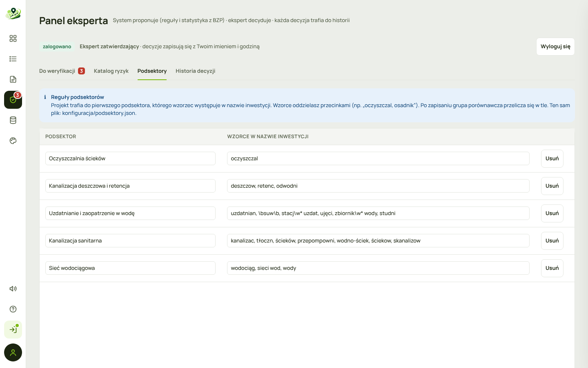](docs/screenshots/10-podsektory.png)

[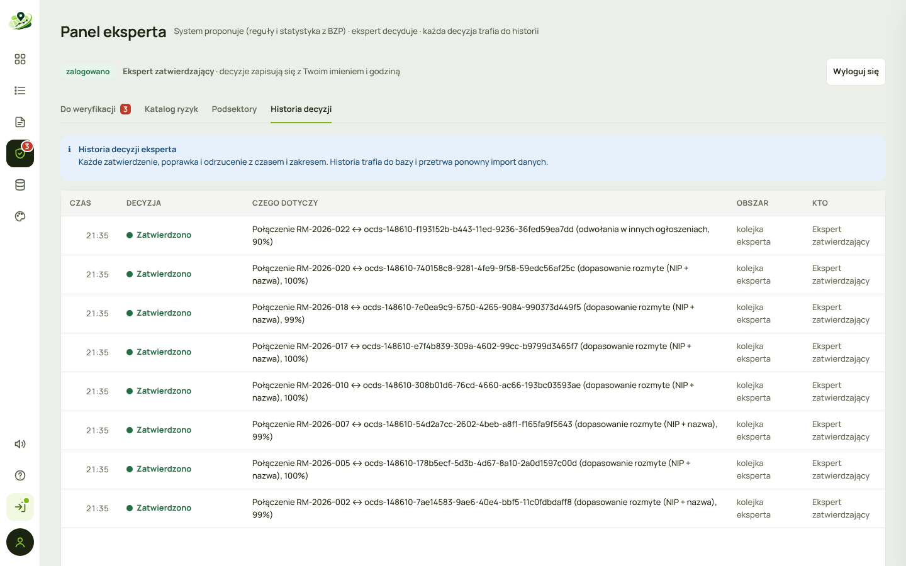](docs/screenshots/11-historia-decyzji.png)

### Dokumenty

Upuszczony plik jest czytany (z OCR dla skanów), przypisywany do projektu po numerze BZP, KPO albo NIP, dzielony na fragmenty z kategoriami R01–R15, a jego daty, kwoty i wykonawca są porównywane z ogłoszeniami w BZP.

[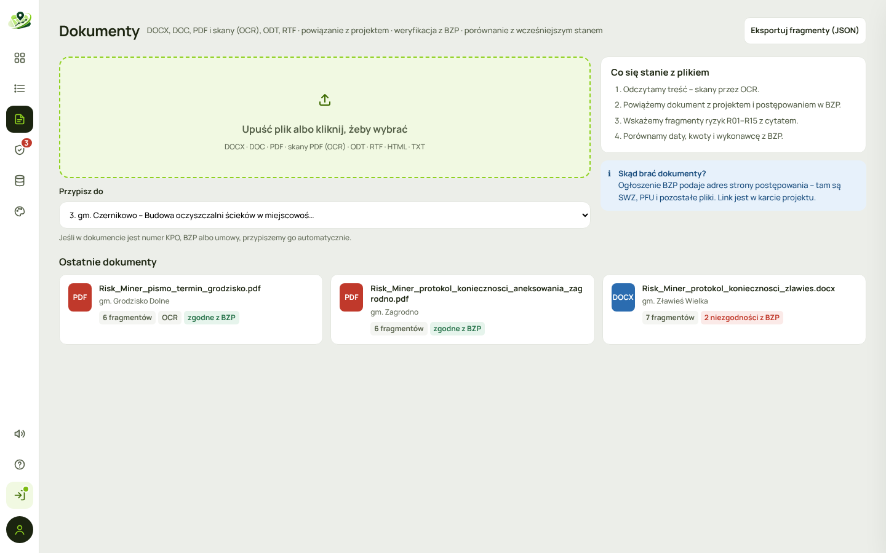](docs/screenshots/12-dokumenty.png)

### Źródła danych i API

Stan każdego źródła, dziennik zapytań, monitoring projektów w toku i raport połączeń do pobrania.

[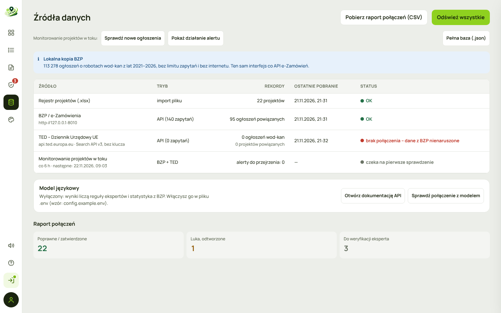](docs/screenshots/14-zrodla-danych.png)

Pełna lista adresów API z rolami jest pod `/api`, a specyfikacja OpenAPI 3.0 pod `/api/openapi.json`.

[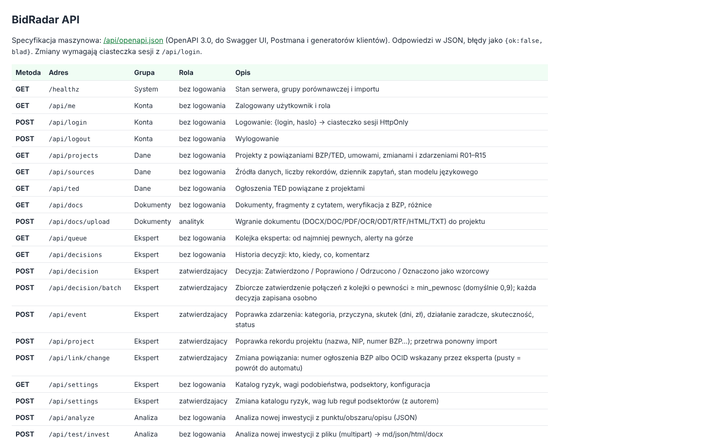](docs/screenshots/15-api.png)

### Na telefonie

Ten sam panel w układzie mobilnym: mapa na pełnym ekranie, dolny pasek nawigacji, karty w jednej kolumnie.

| Panel | Strona główna |
|---|---|
| [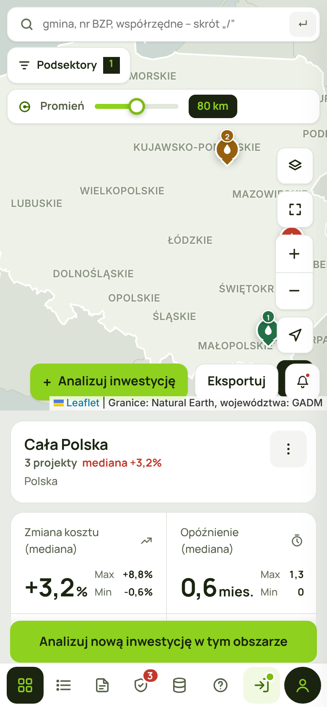](docs/screenshots/16-telefon-panel.png) | [](docs/screenshots/17-telefon-strona.png) |

---

## Wyniki

Zmierzone na bazie pilotażowej. Każdy wynik odtworzysz poleceniem z ostatniej kolumny.

| Pomiar | Wynik | Jak odtworzyć |
|---|---|---|
| Projekty połączone automatycznie z podwójnym potwierdzeniem (numer + NIP) | 14 z 22 | `python3 bidradar_eval.py` |
| Projekty bez dopasowania | 0 z 22 (8 trafia do eksperta) | jak wyżej |
| Wyszukanie postępowania w BZP **bez** numeru ogłoszenia | 93,3% (14 z 15) | `python3 tools/porownanie_llm.py --tylko-nasze` |
| Fakty o realizacji umowy (termin, koszt ±2 pkt proc.) | 93,3% (14 z 15) | jak wyżej |
| Rzeczywista zmiana kosztu w przedziale P10–P90 BidRadar (umowy z 2025–2026) | 79,9% (cel: 80%) | `python3 tools/ocena_predykcji.py` |
| Ocena ryzyka nowych umów, AUROC | 0,66 (model ML na tych samych cechach: 0,67–0,68) | jak wyżej |
| Import 22 projektów z BZP | ok. 6 s | `bash test.sh` |

Jedyna pomyłka w wyszukiwaniu to projekt, którego ogłoszenia o zamówieniu nie ma w kopii BZP. Szczegóły metody: [`raport_predykcji.md`](raport_predykcji.md), [`raport_testu.md`](raport_testu.md).

---

## Źródła danych i łączenie rekordów

| Źródło | Stan | Jak korzystamy |
|---|---|---|
| **BZP / e-Zamówienia** | zintegrowane | API publiczne albo lokalna kopia (113 278 ogłoszeń o robotach wod-kan 2021–2026); ogłoszenia o zamówieniu, wyniku, zmianie i wykonaniu umowy |
| **TED** (Dziennik Urzędowy UE) | zintegrowane | API v3; zamówienia powyżej progów unijnych |
| **Rejestry projektów** (KPO, fundusze UE) | import plików | XLSX, CSV, JSON; numer projektu, odbiorca, NIP, wartość |
| **Dokumenty gmin** | import plików | DOCX, DOC, PDF, skany (OCR), ODT, RTF, HTML |
| **OpenStreetMap** | zintegrowane | położenie siedzib zamawiających |
| BK2021, KPOŚK/AKPOŚK, KIO, NIK, BIP | kolejny etap | konektor tej samej budowy co TED |

| Klucz | Użycie |
|---|---|
| Numer ogłoszenia BZP / TED | klucz główny, normalizowany (`2023/BZP 00129088/01`) |
| OCID | grupuje wszystkie ogłoszenia jednego postępowania |
| NIP | weryfikacja zamawiającego i wyszukiwanie bez numeru |
| Numer projektu (KPO/CST) | identyfikator rekordu |
| Nazwa, przedmiot, miejsce, wartość, daty | dopasowanie bez klucza – z podstawą i procentem pewności, zawsze do decyzji eksperta |

---

## Technologie

| Warstwa | Technologia | Dlaczego |
|---|---|---|
| Serwer i API | Python 3.10+ (tylko biblioteka standardowa), `ThreadingHTTPServer` | zero zależności, uruchomienie jednym poleceniem, łatwy audyt |
| Baza danych | SQLite w trybie WAL | jeden plik, transakcje, równoległy odczyt; migracja do PostgreSQL przy wielu instancjach |
| Interfejs | HTML, CSS, JavaScript bez frameworka; Leaflet 1.9 (mapa); czcionka Manrope | działa offline, ładuje się szybko, WCAG 2.1 AA |
| Dokumenty | `zipfile`/XML (DOCX, ODT), Poppler `pdftotext` (PDF), Tesseract (OCR, język polski), antiword (DOC) | standardowe narzędzia systemowe |
| Eksport Word | własny zapis Office Open XML | bez bibliotek zewnętrznych |
| Statystyka | percentyle i wygładzanie bayesowskie w grupach porównawczych | wynik powtarzalny i wyjaśnialny |
| Model językowy (opcjonalnie) | dowolne API zgodne z OpenAI (np. Gemini), Mistral, Anthropic, Ollama (lokalnie) | domyślnie wyłączony; każdy cytat weryfikowany w dokumencie, dane osobowe maskowane u dostawców spoza UE |
| Wdrożenie | `uruchom.sh`, systemd + Caddy, Docker Compose | od laptopa po serwer z HTTPS |
| Testy | `unittest`, GitHub Actions (Python 3.10 i 3.12) | bez internetu i bez kopii BZP |

---

## Architektura i model danych

| Tabela | Zawartość |
|---|---|
| `projekty` | rekord projektu z rejestru (+ poprawki eksperta) |
| `postepowania`, `ogloszenia` | postępowania (OCID) i ich ogłoszenia z BZP z linkiem i datą pobrania |
| `powiazania` | projekt ↔ postępowanie: metoda, pewność, podstawa, status |
| `umowy`, `zmiany` | umowy z wartością, wypłatą i terminami; zmiany umów z podstawą i przyczyną |
| `zdarzenia` | zdarzenia R01–R15: ogłoszenie, pole, cytat, status |
| `dokumenty`, `fragmenty`, `weryfikacja`, `roznice` | pliki, fragmenty z kategorią, porównanie z BZP, zmiany po ponownej analizie |
| `umowy_sektor` | grupa porównawcza (26 842 umowy) |
| `ted` | ogłoszenia TED i ich powiązania |
| `decyzje`, `korekty` | historia decyzji eksperta i poprawki, które przetrwają ponowny import |
| `ustawienia` | katalog ryzyk, wagi, reguły – zmieniane w aplikacji |
| `uzytkownicy`, `sesje`, `logowania` | konta, sesje i dziennik logowań |
| `log`, `alerty`, `analizy`, `meta`, `geo` | dziennik zapytań do źródeł, alerty monitoringu, historia analiz, stan bazy, geokodowanie |

Pełny opis architektury: [`docs/ARCHITEKTURA.md`](docs/ARCHITEKTURA.md). Mapowanie wymagań, wdrożenie i szczegóły techniczne: [`docs/DOKUMENTACJA_TECHNICZNA.md`](docs/DOKUMENTACJA_TECHNICZNA.md).

---

## Uruchomienie

### 1. Wymagania

- Python 3.10 lub nowszy (bez `pip install`),
- opcjonalnie do PDF i skanów: `poppler-utils`, `tesseract-ocr`, `tesseract-ocr-pol`, `antiword`.

### 2. Start

```bash
bash uruchom.sh
```

Skrypt znajduje plik z projektami i kopię BZP, uruchamia kopię, importuje projekty, buduje w tle grupę porównawczą i otwiera:

| Adres | Co |
|---|---|
| `http://127.0.0.1:8000/` | strona główna |
| `http://127.0.0.1:8000/app` | panel |
| `http://127.0.0.1:8000/login` | logowanie eksperta (hasła startowe w konsoli i w `hasla_startowe.txt`) |
| `http://127.0.0.1:8000/api` | dokumentacja API |

### 3. Analiza własnych plików

```bash
bash test.sh rekord_projektu.xlsx opis_inwestycji.docx
```

Wyniki (rekord projektu i analiza inwestycji w .md, .docx, .html, .json, .csv) trafiają do `wyniki_testu/`.

### 4. Serwer

Serwer w chmurze (Debian/Ubuntu, np. Google Cloud) – jako root, z plikami `risk_miner_bzp_kopia.zip` i `Risk_Miner_dane_projekty.xlsx` w `/root`:

```bash
CADDY=1 bash deploy/instaluj.sh 8000                          # usługi systemd + HTTPS (Caddy); domena z IP maszyny: 1-2-3-4.sslip.io
CADDY=1 bash deploy/instaluj.sh 8000 bidradar.example.pl      # z własną domeną
bash deploy/instaluj.sh 8000                                  # bez HTTPS, port 8000 otwarty na świat
```

Inne sposoby:

```bash
RM_DEMO_PASSWORD=wybrane-haslo bash uruchom.sh --siec           # ręcznie, dostęp z sieci na porcie 8000
docker compose up -d                                          # w kontenerze
```

Zalecana maszyna: 2 vCPU i 4 GB RAM (przy częstym OCR: 8 GB).

---

## Konfiguracja

Plik `.env` (wzór: `config.example.env`). Bez niego obowiązują wartości domyślne.

| Klucz | Domyślnie | Znaczenie |
|---|---|---|
| `RM_HOST` / `RM_PORT` | `127.0.0.1` / `8000` | adres serwera; `0.0.0.0` = dostęp z sieci |
| `RM_BZP_URL` | `http://127.0.0.1:8010` | API BZP: kopia lokalna albo produkcja e-Zamówień |
| `RM_DB` / `RM_OUT` | `bidradar.db` / `out` | baza i folder eksportów |
| `RM_AUTH` | `on` | `off` = praca bez kont |
| `RM_SESSION_H` | `12` | ważność sesji w godzinach |
| `RM_MONITOR_H` | `6` | co ile godzin sprawdzać nowe ogłoszenia; `0` = wyłączone |
| `RM_MAX_MB` | `40` | maksymalny rozmiar wgrywanego pliku |
| `RM_DEMO_PASSWORD` | losowe | stałe hasło kont startowych |
| `LLM_PROVIDER` | puste = wyłączony | `openai` (każde API zgodne z OpenAI), `mistral`, `anthropic`, `ollama` |
| `LLM_BASE_URL` / `LLM_MODEL` / `LLM_API_KEY` | – | adres API, model, klucz |
| `LLM_MODEL_ZAPASOWY` | – | model używany, gdy główny jest przeciążony |

Bez zmian w kodzie zmienisz też w aplikacji: katalog ryzyk, wagi podobieństwa i reguły podsektorów (**Panel eksperta**), a w plikach `konfiguracja/` – źródła danych i nowy sektor.

---

## Konta i role

[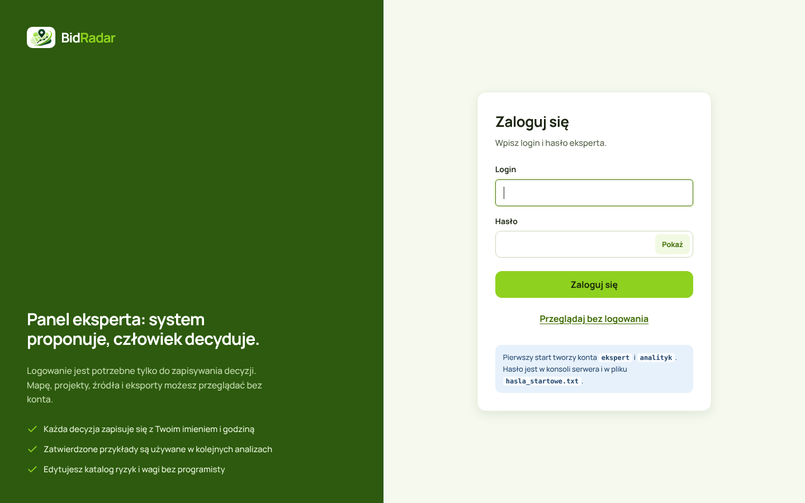](docs/screenshots/13-logowanie.png)

| Rola | Może |
|---|---|
| bez logowania | przeglądać mapę, projekty, źródła i historię; eksportować; analizować nową inwestycję |
| `analityk` | jak wyżej oraz wgrywać dokumenty i rekordy |
| `zatwierdzajacy` | wszystko: decyzje, poprawki zdarzeń, rekordów i powiązań, katalog, wagi, podsektory, import, monitoring |

```bash
python3 rm_auth.py dodaj jan.kowalski --rola zatwierdzajacy --nazwa "Jan Kowalski"
python3 rm_auth.py lista
python3 rm_auth.py haslo ekspert
```

Hasła przez scrypt z solą, ciasteczko sesji `HttpOnly` i `SameSite=Strict`, kontrola `Origin` przy zapisie, limit nieudanych logowań.

---

## Testy

```bash
python3 -m unittest discover -s tests -v
```

34 testy: logowanie i role, CSRF, łączenie, TED, dokumenty, monitoring, eksporty (.docx), zatwierdzanie zbiorcze, poprawki eksperta i ich trwałość po imporcie, podsektory, OpenAPI, maskowanie danych, pliki statyczne. Nie potrzebują internetu ani kopii BZP.

---

## Ograniczenia

- BZP podaje adres zamawiającego, a nie placu budowy – pinezka stoi w siedzibie gminy.
- Projekty KPO nie mają numeru BZP, więc ich dopasowanie jest zawsze propozycją do decyzji eksperta.
- Brak ogłoszenia w kopii BZP nie oznacza braku publikacji – takie przypadki są oznaczone.
- TED obejmuje zamówienia powyżej progów unijnych, więc dla małych inwestycji gminnych często nic nie znajduje.
- Ocena ryzyka pojedynczej umowy z danych sprzed przetargu ma ograniczoną trafność (AUROC ok. 0,66) – dlatego pokazujemy przedziały z liczebnością próby, a nie jedną „pewną” liczbę.

---

## Rozwiązywanie problemów

| Problem | Rozwiązanie |
|---|---|
| `database is locked` przy pierwszym starcie | zaktualizuj do bieżącej wersji – baza działa w trybie WAL z ponawianiem zapisu |
| „Kopia BZP nie odpowiada” | uruchom aplikację przez `bash uruchom.sh` (startuje kopię sama) albo ustaw `RM_BZP_URL` |
| Port 8000 zajęty | `RM_PORT=8080 bash uruchom.sh` |
| PDF bez tekstu / skan nieczytany | zainstaluj `poppler-utils` i `tesseract-ocr-pol` |
| Animacje nie działają | system ma włączone „ogranicz ruch”; w GNOME: `gsettings set org.gnome.desktop.interface enable-animations true`, potem restart przeglądarki |
| Model językowy: 503 lub przekroczony czas | ustaw `LLM_MODEL_ZAPASOWY` w `.env`; analiza i tak działa na regułach |
| Model językowy: 400 „invalid API key” | sprawdź, czy w `.env` jest prawdziwy klucz, bez spacji i cudzysłowów |
| Brak dostępu z innego komputera | `bash uruchom.sh --siec` i otwarty port 8000 w zaporze |

---

## Struktura repozytorium

```
server.py            serwer HTTP, logowanie, API, monitoring
rm_ingest.py         import, łączenie z BZP, zdarzenia, poprawki eksperta
rm_ted.py            konektor TED
rm_benchmark.py      grupa porównawcza
rm_invest.py         analiza nowej inwestycji
rm_docs.py           dokumenty: odczyt, OCR, fragmenty, weryfikacja z BZP
rm_record.py         rekord projektu i eksporty
rm_report.py         raport HTML do druku i PDF
rm_docx.py           eksport do Worda
rm_auth.py           konta, role, sesje
rm_config.py         konfiguracja bez kodu
rm_llm.py            opcjonalny model językowy z bezpiecznikami
landing.html, login.html, bidradar_ui.html   strony
static/              logo i ikona
konfiguracja/        podsektory, wagi, źródła
tools/               szablony stron, ocena trafności, porównanie
tests/               testy automatyczne
deploy/              instalator, usługi systemd
docs/                architektura, dokumentacja techniczna, zrzuty ekranu
```

---

## Licencje danych

Ogłoszenia: Biuletyn Zamówień Publicznych (e-Zamówienia), TED – Dziennik Urzędowy UE. Geokodowanie: OpenStreetMap / Nominatim (ODbL). Granice: Natural Earth (domena publiczna), województwa: GADM (użytek niekomercyjny). Mapa: Leaflet (BSD-2-Clause). Czcionka: Manrope (SIL Open Font License). Wyniki mają charakter pomocniczy i wymagają weryfikacji eksperta.
